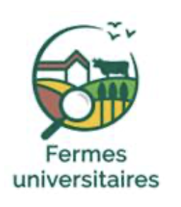
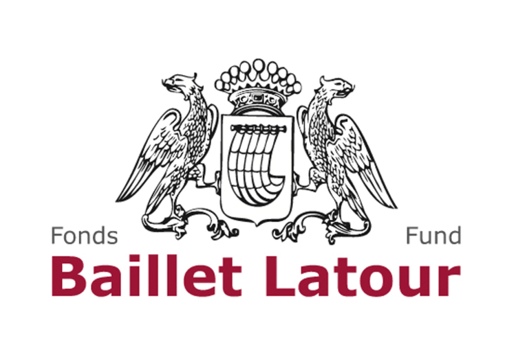

## Le site

Ce site rassemble les résultats des essais et travaux de recherche en maraîchage menés au **PEPA Lab** (Earth and Life Institute, UCLouvain), et présente le **conservatoire de tomates** des Fermes universitaires. Il s'adresse aux maraîcher·ères, aux conseiller·ères, aux étudiant·es et aux chercheur·ses.

Il est organisé en quatre parties :

- les **[fiches d'essais](fiches.qmd)**, qui résument chaque essai en une page ;
- les **[protocoles](protocoles.qmd)**, pour refaire nos mesures chez vous ;
- le **[conservatoire de tomates](tomates/index.qmd)** ;
- les **[données](donnees.qmd)** de nos essais, ouvertes et réutilisables.

## Les essais et leurs limites

Nos essais sont menés sur les fermes universitaires de Lauzelle (Louvain-la-Neuve) et de Marbaix (Chaumont-Gistoux). La plupart sont réalisés dans le cadre de **mémoires de fin d'études** : ils portent en général sur une seule saison et un seul site, et n'ont pas été relus par des pairs comme un article scientifique.

Chaque fiche indique donc son niveau de confiance : [Préliminaire]{.statut-badge .statut-preliminaire} une saison, un mémoire · [Consolidé]{.statut-badge .statut-consolide} confirmé sur plusieurs saisons ou sites · [Publié]{.statut-badge .statut-publie} publié dans une revue scientifique.

## Le conservatoire de tomates

Le conservatoire répertorie les variétés de tomates cultivées et préservées par les **Fermes universitaires de l'UCLouvain**, grâce au soutien du **Fonds Baillet Latour**. Il rassemble aujourd'hui plus d'une centaine de variétés venues de Belgique, de France, des États-Unis, de Russie et de bien d'autres pays : tomates cerises, cocktail, beefsteak, prunes et variétés anciennes de toutes les couleurs.

**Pourquoi un conservatoire ?** Beaucoup de variétés anciennes ou locales ne sont plus vendues et risquent de disparaître. En les cultivant, en multipliant leurs graines et en décrivant leurs caractéristiques (précocité, forme, couleur, goût, rendement, comportement en plein champ), le conservatoire **préserve cette diversité** et la rend utile aux maraîcher·ères, aux jardinier·ères et à la recherche.

Le [catalogue](tomates/index.qmd) présente chaque variété avec ses descripteurs et, quand elles existent, ses photos. Les variétés multipliées une année donnée sont signalées. La liste complète est téléchargeable en CSV ou en Excel.

## Réutiliser nos contenus

Les textes du site sont sous licence **CC BY 4.0** : vous pouvez les reprendre et les adapter en citant la source. La licence des données est indiquée sur chaque fiche ; voir aussi la page [Données](donnees.qmd).

## Contact

PEPA Lab, Earth and Life Institute, UCLouvain.

[À COMPLÉTER : personne de contact et adresse e-mail ; pour le conservatoire, conditions d'accès aux graines]

## Partenaires

::: {.tom-logos}
{fig-alt="UCLouvain"}
{fig-alt="Fermes universitaires de l'UCLouvain"}
{fig-alt="Fonds Baillet Latour"}
:::
