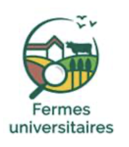

::: {.tom-apropos-logo}
{width=90px fig-alt="Fermes universitaires de l'UCLouvain"}
:::

## Le conservatoire

Le conservatoire de tomates répertorie les variétés cultivées et préservées par les **Fermes universitaires de l'UCLouvain**, grâce au soutien du **Fonds Baillet Latour**. Il rassemble aujourd'hui plus d'une centaine de variétés venues de Belgique, de France, des États-Unis, de Russie et de bien d'autres pays : tomates cerises, cocktail, beefsteak, prunes et variétés anciennes de toutes les couleurs.

## Pourquoi un conservatoire ?

Beaucoup de variétés anciennes ou locales ne sont plus vendues et risquent de disparaître. En les cultivant, en multipliant leurs graines et en décrivant leurs caractéristiques (précocité, forme, couleur, goût, rendement, comportement en plein champ), le conservatoire **préserve cette diversité** et la rend utile aux maraîcher·ères, aux jardinier·ères et à la recherche.

## Le catalogue

Le [catalogue](index.qmd) présente chaque variété avec ses descripteurs et, quand elles existent, ses photos. Les variétés multipliées une année donnée sont signalées. La liste complète est téléchargeable en CSV ou en Excel.

## Contact

[À COMPLÉTER : personne de contact, adresse e-mail, conditions d'accès aux graines]

::: {.tom-logos}
{fig-alt="UCLouvain"}
{fig-alt="Fermes universitaires de l'UCLouvain"}
{fig-alt="Fonds Baillet Latour"}
:::
