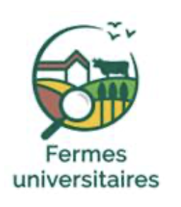
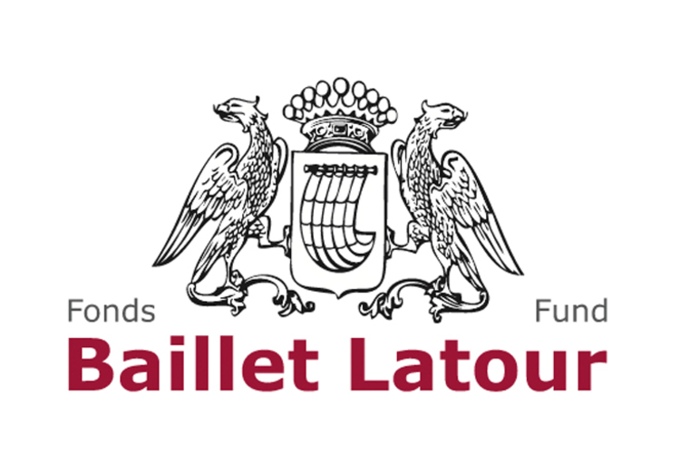

::: {.callout-note appearance="simple" icon=false}
Le conservatoire rassemble **plus d'une centaine de variétés de tomates**, cultivées et multipliées chaque année aux Fermes universitaires de l'UCLouvain avec le soutien du Fonds Baillet Latour. Filtrez la collection par type, couleur, forme ou précocité, puis cliquez sur une variété pour voir sa fiche complète. [En savoir plus sur le conservatoire](a-propos.qmd).
:::

```{=html}
<div id="tomates-app">
  <div class="tom-kpis" id="tom-kpis"></div>

  <div class="tom-layout">
    <div class="tom-filtres" role="search" aria-label="Filtres">
      <label for="tom-recherche" class="tom-filtre-titre">Rechercher une variété</label>
      <input id="tom-recherche" type="search" class="form-control form-control-sm" placeholder="Nom du cultivar…">
      <div id="tom-groupes"></div>
      <button type="button" id="tom-reset" class="tom-reset">Tout afficher</button>
      <div class="tom-export">
        <span class="tom-filtre-titre">Télécharger la liste</span>
        <a class="res-btn res-data" href="varietes.csv" download><i class="bi bi-filetype-csv"></i> CSV</a>
        <a class="res-btn res-data" href="varietes.xlsx" download><i class="bi bi-file-earmark-excel"></i> Excel</a>
      </div>
    </div>

    <section>
      <p class="tom-compte" id="tom-compte" aria-live="polite"></p>
      <div class="tom-grille" id="tom-grille"></div>
    </section>
  </div>

  <div class="modal fade" id="tom-modal" tabindex="-1" aria-labelledby="tom-modal-titre" aria-hidden="true">
    <div class="modal-dialog modal-lg modal-dialog-scrollable">
      <div class="modal-content">
        <div class="modal-header">
          <h2 class="modal-title" id="tom-modal-titre"></h2>
          <button type="button" class="btn-close" data-bs-dismiss="modal" aria-label="Fermer"></button>
        </div>
        <div class="modal-body" id="tom-modal-corps"></div>
      </div>
    </div>
  </div>
</div>

<div class="tom-logos">
  
  
  
</div>

<script src="tomates.js"></script>
```
